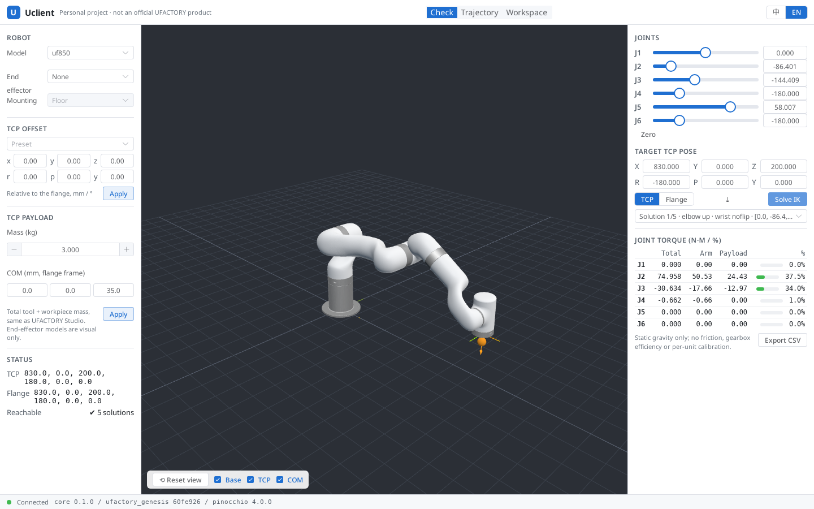

# Uclient

> **Uclient is currently a personal project in development. It is not an official UFACTORY product and is not affiliated with or endorsed by UFACTORY.**

[中文说明](README.zh.md)

Uclient is an open-source desktop client (Tauri v2 + Vue 3) for **kinematics, dynamics and 3D visualization** of UFACTORY robot arms, built on top of [`ufactory_genesis`](https://github.com/xArm-Developer/ufactory_genesis) and [Pinocchio](https://github.com/stack-of-tasks/pinocchio). Its terms and units follow UFACTORY Studio (mm / °, TCP Offset, TCP Payload) so Studio users feel at home. It does not connect to real robots and does not do reinforcement learning.

Supported models: **UF850, xArm5/6/7 (`_1305` revision only), Lite6**. Platform: **Linux** (Windows 10+ packaging is planned for milestone M5; macOS is not supported).



## Status

Early development (milestone M0/M1, see [docs/DESIGN.md](docs/DESIGN.md) §14).

| Area | State |
|---|---|
| Python sidecar (`core/`): JSON-RPC 2.0 over WebSocket on 127.0.0.1, token auth | ✅ |
| FK, Jacobian, multi-solution IK (pure Pinocchio, damped least squares) | ✅ |
| Payload-aware gravity torque (arm / payload split), RNEA, mass matrix | ✅ |
| `check.pose`: TCP pose → all IK solutions + torques (U1 golden case) | ✅ |
| Tauri shell: sidecar lifecycle, port/token handshake, crash restart | ✅ |
| Check page: model/TCP/payload panels, joint sliders, IK, torque table, CSV, 3D view | ✅ first version |
| Linux deb packaging in CI | ✅ (unsigned, development builds) |
| Trajectory + τ(t) curves (M3), workspace & calibration (M4) | ⏳ |

Results are **static models**: nominal URDF inertia, no friction, gearbox efficiency or per-unit calibration. Rated torques are read at runtime from `ufactory_genesis` (currently pinned to commit `60fe926`, development values) and will switch to the release carrying official ratings.

## Development (Linux)

Requirements: Python 3.12, Node 22 + pnpm, Rust stable, and the Tauri system packages (`libwebkit2gtk-4.1-dev librsvg2-dev libappindicator3-dev patchelf`).

```bash
# 1. Python sidecar + pinned ufactory_genesis (never modified, cloned into third_party/)
python3.12 -m venv .venv
python scripts/fetch_ufg.py
.venv/bin/pip install -e third_party/ufactory_genesis -e "core[dev]"
.venv/bin/python -m pytest core/tests

# 2. Frontend assets and tests
.venv/bin/python scripts/sync_assets.py         # robot URDF + GLB -> apps/desktop/public/robot-assets
cd apps/desktop && pnpm install && pnpm test

# 3. Run the desktop app against the dev sidecar
UCLIENT_CORE_CMD="$PWD/../../.venv/bin/python -m uclient_core" pnpm tauri dev

# 4. Package (deb)
cd ../.. && .venv/bin/python scripts/build_sidecar.py   # PyInstaller onedir + smoke test
cd apps/desktop && pnpm tauri build --config src-tauri/tauri.bundle.conf.json
```

You can also run the frontend in a browser: start `python -m uclient_core`, then open `http://localhost:1420/?port=<port>&token=<token>` using the handshake line it prints.

## Repository layout

```
apps/desktop/        Vue 3 + TS + Element Plus frontend, three.js viewport, Tauri shell (src-tauri/)
core/uclient_core/   Python sidecar: server, api/, units.py, backend/ adapter layer
schema/api.v1.json   JSON-RPC API description
scripts/             fetch_ufg.py, sync_assets.py, build_sidecar.py
docs/DESIGN.md       Design document (Chinese)
```

## License

MIT © 2026 Daniel Wang. Robot model assets come from `ufactory_genesis` and its upstream xArm ROS packages; see [NOTICE](NOTICE).
