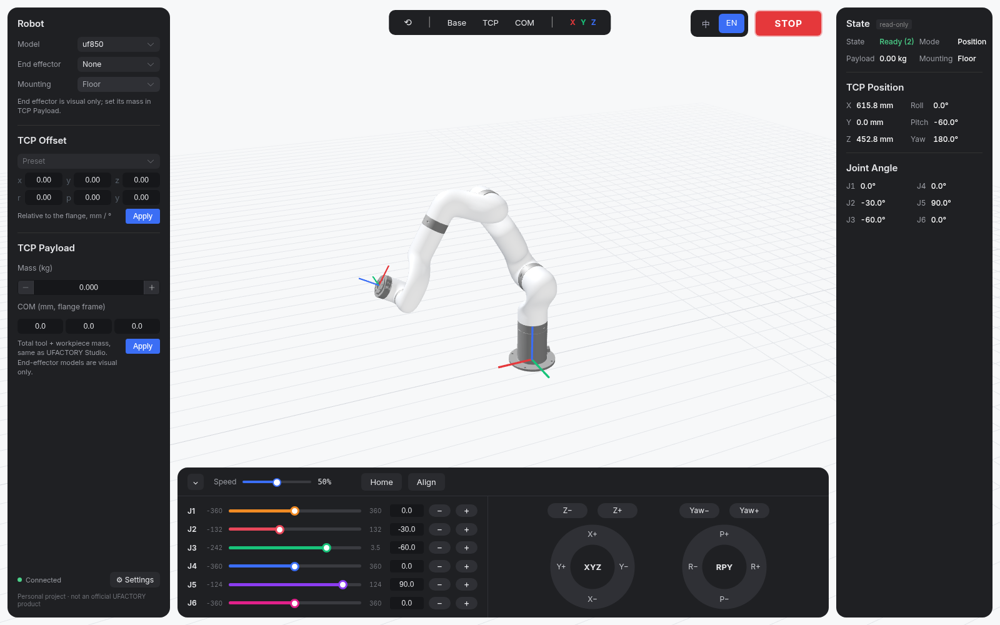
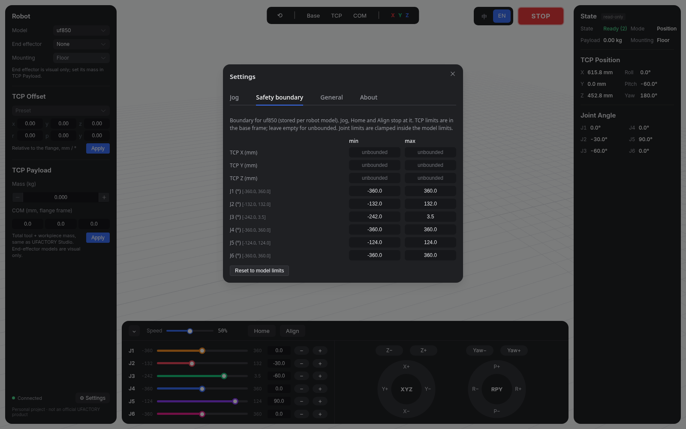

# UGClient

**UGClient = UFACTORY Genesis Client**（原名 *Uclient*）。

> **UGClient 目前是个人项目，处于开发阶段，不是 UFACTORY 官方产品，与 UFACTORY 无隶属或背书关系。**

[English](README.md)

UGClient 是一个开源桌面客户端（Tauri v2 + Vue 3），基于 [`ufactory_genesis`](https://github.com/xArm-Developer/ufactory_genesis) 和 [Pinocchio](https://github.com/stack-of-tasks/pinocchio)，为 UFACTORY 机械臂提供**运动学、动力学计算和 3D 可视化**。术语和单位与 UFACTORY Studio 一致（mm / °、TCP Offset、TCP Payload）。**所有运动都只在仿真中进行**：不连接真机，也不做强化学习。

支持机型：**UF850、xArm5/6/7（仅 `_1305` 版本）、Lite6**。平台：**Linux**（deb 包）。Windows 10+ 打包在计划中，暂不支持 macOS。



## 功能

**界面布局。** 浅色 3D 场景铺满整个窗口，上面浮着几块深色圆角面板：
- 左侧面板：机型、末端工具、TCP 偏移和 TCP 负载，底部是连接状态和"设置"按钮。
- 右侧面板（只读）：仿真状态、模式、负载、安装方式、TCP 位姿和关节角度。
- 顶部工具栏：重置视角，以及 Base / TCP / COM 显示开关。右上角是中/EN 语言切换和红色 STOP 按钮。
- 底部：可折叠的运动控制栏。

**运动控制栏（仅仿真）。**
- J1-J6 滑条，带关节限位、数值框和 -/+ 按钮。
- Z-/Z+、Yaw-/Yaw+ 按钮，以及圆形的 XYZ（X+/X-/Y+/Y-）和 RPY（P+/P-/R+/R-）点动盘。TCP 点动在基坐标系下进行，用引擎的逆解计算。
- **单击**走一步（默认 1 mm / 1°，可在设置中修改）；**按住**超过 300 ms 连续运动，松开即停。
- 速度滑条默认 50%，100% 对应直线 230 mm/s、关节和旋转 40 °/s。
- **回零**（所有关节回到 0）和**对齐**（只转动最后三个关节，让末端朝下）也是单击/按住两种用法：单击在关节空间朝目标走一步，按住则连续运动，直到松开或到达目标。
- 点 **STOP** 或松开按住的按钮，运动停止，仿真状态变为 4。状态码：2 = 就绪，1 = 运动中，4 = 已停止。
- 碰到关节限位、安全边界或目标不可达时，运动停止并弹窗提示。

**3D 视图。** 基坐标系和 TCP 坐标轴按 X 红、Y 绿、Z 蓝绘制；设置了负载时会显示负载质心。

**设置**（保存在本地）：
- 点动：直线单击步长（mm）和角度单击步长（°，用于关节和 RPY）。
- 安全边界（按机型分别保存）：基坐标系下 TCP X/Y/Z 的最小值和最大值，以及每个关节的最小值和最大值；关节范围不能超出机型限位。点动、回零和对齐到达边界即停止。
- 通用：语言、默认机型、启动时恢复上次配置。
- 关于：版本信息、许可证和个人项目说明。



**暂无界面的引擎接口。** Python 计算引擎仍提供：负载感知重力扭矩（`dyn.gravity`，本体/负载分解、占最大扭矩百分比），`check.pose`（TCP 位姿 → 全部逆解及对应扭矩），以及 `kin.ik`、`kin.fk`、`kin.jacobian`、`dyn.rnea`、`dyn.mass_matrix`。接口说明见 [schema/api.v1.json](schema/api.v1.json)。目前界面上没有扭矩表、CSV 导出和逆解输入表单。

## 当前状态

早期开发（见 [docs/DESIGN.md](docs/DESIGN.md) §14）。

| 模块 | 状态 |
|---|---|
| Python 计算引擎（`core/`）：127.0.0.1 上的 WebSocket JSON-RPC 2.0，token 认证 | 已完成 |
| FK、雅可比、多解 IK（纯 Pinocchio，阻尼最小二乘） | 已完成 |
| 负载感知重力扭矩、RNEA、质量矩阵（仅接口，暂无界面） | 已完成 |
| Tauri 壳：引擎生命周期、端口/token 握手、崩溃重启 | 已完成 |
| 主界面：浮动面板、仿真运动控制栏、RGB 坐标轴、设置页 | 已完成 |
| CI 中打 Linux deb 包 | 已完成（未签名的开发构建） |
| 扭矩视图、轨迹与扭矩随时间变化曲线、工作空间与标定 | 计划中 |

计算结果来自**静态模型**：URDF 名义惯性参数，不含摩擦、减速器效率和单机标定。最大关节扭矩（[UFACTORY 关节参数](https://docs.supportarticle.ufactory.cc/zhHans/support_articles/hardware/ufactory-joint-parameters.html)）运行时从 `ufactory_genesis` 读取，当前锁定 commit `be49519`，已包含 UFACTORY 官方关节扭矩限值。

## 开发（Linux）

需要 Python 3.12、Node 22 + pnpm、Rust stable，以及 Tauri 系统依赖（`libwebkit2gtk-4.1-dev librsvg2-dev libappindicator3-dev patchelf`）。

```bash
# 1. Python 引擎 + 锁定版本的 ufactory_genesis（只读使用，克隆到 third_party/）
python3.12 -m venv .venv
python scripts/fetch_ufg.py
.venv/bin/pip install -e third_party/ufactory_genesis -e "core[dev]"
.venv/bin/python -m pytest core/tests

# 2. 前端资源与测试
.venv/bin/python scripts/sync_assets.py
cd apps/desktop && pnpm install && pnpm test

# 3. 用开发版引擎运行桌面应用
UGCLIENT_CORE_CMD="$PWD/../../.venv/bin/python -m ugclient_core" pnpm tauri dev

# 4. 打包（deb）
cd ../.. && .venv/bin/python scripts/build_sidecar.py
cd apps/desktop && pnpm tauri build --config src-tauri/tauri.bundle.conf.json
```

## 许可证

MIT © 2026 Daniel Wang。机器人模型资源来自 `ufactory_genesis` 及其上游 xArm ROS 描述包，详见 [NOTICE](NOTICE)。
