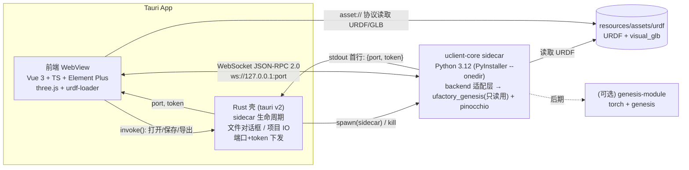

# Uclient 设计文档 v0.3（草案）

> 状态：草案，v0.1 的全部待确认问题均已答复并落实到正文
> 依赖库：`ufactory_genesis`（MIT，现托管于 `xArm-Developer/ufactory_genesis`，本文基于本地 commit `60fe926`，v0.3.x）
> 性质：开发阶段的**个人项目**，不是 UFACTORY 官方产品

## 修订记录

| 版本 | 日期 | 变更 |
|---|---|---|
| v0.3.2 | 2026-10-10 | 末端默认 TCP 改为 URDF tcp 关节（G2 172 mm，Lite6 夹爪 83.6 mm）；`tool_tip_offset_z_m` 不是 TCP。 |
| v0.3.1 | 2026-10-10 | Linux 只打 deb 包，取消 AppImage（用户决定）；CI/发布流程、README 同步更新。 |
| v0.3 | 2026-10-10 | 资源 `assets/urdf` 按 `ufactory_genesis` NOTICE 署名直接随包分发，不再单独核验；v0.1 只打 Linux 包（ubuntu-22.04：AppImage + deb），Windows 10+ 打包移到后续里程碑，代码保持跨平台；额定扭矩运行时从 `ufactory_genesis` 读取、不在本地硬编码，并锁定即将发布的官方额定值版本；xArm 系列只支持 `_1305`；所有待确认问题已关闭。 |
| v0.2 | 2026-10-10 | 确认个人仓库 `DanielWang123321/Uclient`，README 必须声明“个人项目、非 UFACTORY 官方产品”；校核输入位姿默认 TCP（已叠加 TCP Offset）；负载定义与 UFACTORY Studio 完全一致；前端由 Svelte 5 改为 Vue 3 + TypeScript + Vite + Element Plus，曲线库选 uPlot；暂不修改 `ufactory_genesis`，负载感知的重力/RNEA、纯 Pinocchio IK、FK/Jacobian 都在 sidecar 中实现，经适配层 `backend/` 隔离，上游有接口后再切换；平台收窄为 Linux + Windows 10+，移除 macOS 构建和签名公证；更新待确认问题。 |
| v0.1 | 2026-10-10 | 初稿。 |

---

## 1. 目标与非目标

**目标**
- G1 桌面客户端，基于 Tauri v2，开源（MIT），托管在个人仓库 `github.com/DanielWang123321/Uclient`。v0.1 只发布 **Linux** 安装包；代码保持跨平台，**Windows 10+** 打包在后续里程碑（M5）加入；macOS 暂不支持。
- G2 对 UFACTORY 机械臂（UF850、xArm5/6/7、Lite6，可选 Gripper G2 / Bio Gripper G2 / Lite6 Gripper / Lite6 Vacuum）提供：正逆运动学（FK/IK）、静力/逆动力学扭矩、可达性与工作空间、轨迹回放与扭矩曲线、CSV/报告导出。
- G3 3D 可视化：直接渲染 `ufactory_genesis/assets/urdf` 中的 URDF + Draco GLB。
- G4 交互和单位约定对齐 UFACTORY Studio（mm/°、TCP Offset/TCP Payload 定义一致），让 Studio 用户零学习成本。
- G5 计算核心只依赖 Pinocchio（`pin==4.0.0`），安装包保持在“几十 MB”量级。

**非目标**
- 不做强化学习、训练、`ufactory.training` 相关任何功能。
- MVP 不连接真机（不控制、不读状态）；真机读取 SN 标定参数作为后期可选功能。
- 不做 Blockly 编程、不做 Studio 的完整替代品。
- MVP 不打包 Genesis / PyTorch 物理仿真（后期作为可选模块）。
- 不做碰撞检测和路径规划（后期可考虑 `coal`）。
- 现阶段不修改 `ufactory_genesis`：缺失的接口全部在 Uclient sidecar 内实现（§9）。
- v0.1 不提供 Windows 安装包；暂不支持 macOS。
- 不支持 xArm 旧版本机型：xArm5/6/7 只支持 `_1305` 版本（即 `ROBOT_PROFILES` 中的 `xarm5_1305`/`xarm6_1305`/`xarm7_1305`），另有 UF850、Lite6。

## 2. 目标用户与核心用例

**用户**：选型/应用工程师（判断负载和姿态是否超扭矩）、集成商与技术支持、教学与研究人员、`ufactory_genesis` 开发者（需要一个可视的交叉验证工具）。

| # | 用例 | 输入 | 输出 |
|---|---|---|---|
| U1 | **姿态+负载扭矩校核**（金标准用例）| UF850，TCP 位姿 `[830, 0, 200, -180, 0, 0]`（mm/°，**默认是 TCP 位姿，已叠加当前 TCP Offset**），负载 3.0 kg，质心 `[0, 0, 35]` mm（相对法兰，与 Studio 一致）| 全部 IK 解列表；选中解（默认肘上）的各关节重力扭矩、占额定扭矩百分比，拆分为“本体”和“负载”两部分 |
| U2 | 可达性 / IK | 目标 TCP 位姿 + TCP Offset | 是否可达、所有解（肘上/肘下、腕翻转）、关节限位余量、最近可达点 |
| U3 | 工作空间可视化 | 机型、TCP、可选固定姿态 | 点云/切片，按“最大扭矩利用率”或“可操作度”着色 |
| U4 | 轨迹回放 + 扭矩曲线 | 关节或笛卡尔路点 + 速度/加速度 | 3D 动画、`τ(t)`（RNEA，含惯性项）、峰值和越限提示 |
| U5 | 导出 | 任意结果 | CSV、JSON、HTML/PDF 报告（含截图和假设说明） |
| U6 | 配置比较 | 2~N 套负载/TCP 配置 | 同一位姿下扭矩对比表 |

U1 已在盒子里验证过（脚本 `/home/box/dev/ufactory_genesis_calc/calc_uf850_torque.py`，当时 TCP Offset = 0，即 TCP 与法兰重合，所以这组数对应“TCP Offset 为零”的 TCP 输入）：
q = `[0, −86.401, −144.409, −180, 58.007, −180]°`，τ ≈ J2 74.958 N·m，J3 −30.634 N·m，J4 −0.662 N·m，其余 ≈ 0；负载部分（J2 24.427、J3 −12.972）与 `Jᵀ·F` 独立核对一致（误差 < 0.001 N·m）。按当前仓库的 `effort_limits_nm` 折算为 J2 37.5%、J3 34.0%；**这两个百分比会随 `ufactory_genesis` 即将发布的官方额定扭矩而变化**，扭矩绝对值不变。这组数会直接成为测试金标准（§11）。若用户设了非零 TCP Offset（例如 G2 的 172 mm），同一个 TCP 位姿对应的法兰位置会变，扭矩也随之变化，这是预期行为。

## 3. 功能清单（MVP vs 后续）

| 模块 | MVP（v0.1） | v0.2 | 后续 |
|---|---|---|---|
| 机型 | uf850 / xarm5/6/7 / lite6（来自 `ufactory.robots.registry.ROBOT_PROFILES`）| 末端：G2、Bio G2、Lite6 Gripper/Vacuum 的外观 | 安装方式（壁挂/倒装 → 改重力向量）|
| TCP | TCP Offset `[x,y,z,r,p,y]`（mm/°，相对法兰）| 末端默认 TCP 取自 ufactory_genesis 组合 URDF 的 tcp 关节（G2 172 mm、Lite6 夹爪 83.6 mm、BIO G2 按 URDF、Lite6 吸头 0）| 5 点标定导入 |
| 负载 | mass + COM（与 Studio 完全一致：工具+工件总质量，COM 相对法兰）| 惯量张量（可选）| 负载辨识数据导入 |
| 关节点动 | 滑块 + 数值输入，限位显示 | 键盘步进 | — |
| 笛卡尔点动 | 基坐标系 / 工具坐标系 XYZ RPY 步进（走 IK）| 3D 拖拽 TCP gizmo | — |
| FK/IK | FK；Pinocchio 阻尼最小二乘 IK，多初值求全部解 | 解析解（6 轴）| 冗余 7 轴零空间滑块 |
| 动力学 | 静态重力扭矩 + 本体/负载分解 + 额定百分比 | RNEA 逆动力学、质量矩阵 | 摩擦/减速器效率模型 |
| 轨迹 | — | 关节空间梯形/S 曲线插值，回放 + 扭矩曲线 | 笛卡尔直线 / 圆弧；导入 Studio/SDK 轨迹 |
| 工作空间 | — | 采样点云 + 扭矩利用率着色 | 切片、包络网格 |
| 导出 | CSV / JSON | HTML 报告（含截图）| PDF |
| 标定 | 默认运动学 | 导入 SN 标定 YAML（`build_calibrated_urdf`）| 从真机 IP 读取 SN |
| 平台 | Linux | — | Windows 10+（M5）；macOS（待定）|
| 物理仿真 | — | — | Genesis 可选模块（独立下载）|
| i18n | 中/英 | — | — |

## 4. 架构与进程模型



**决策**
- **通信：WebSocket JSON-RPC 2.0（只绑定 127.0.0.1，随机端口 + 一次性 token）**。不选 stdio 的原因：stdio 必须经 Rust 转发（WebView 不能直接读子进程管道），轨迹回放、工作空间采样这类“流式通知”会多一层序列化；WebSocket 让前端直连，Rust 只管启动。启动握手仍用 stdio：sidecar 启动后在 stdout 首行打印 `{"port":..., "token":"..."}`，Rust 读取后通过 Tauri event 交给前端。
- **Rust 壳保持很薄**：`tauri-plugin-shell`（sidecar）、`tauri-plugin-dialog`、`tauri-plugin-fs`（只限项目目录）、`tauri-plugin-updater`（后期）。sidecar 崩溃时 Rust 自动重启（最多 3 次），前端显示“计算引擎已重启”。
- **前端框架：Vue 3（Composition API）+ TypeScript + Vite + Element Plus**（按用户决定）。
  - Element Plus 提供表单、数字输入（`el-input-number` 带步长/精度）、滑块、下拉、表格、Tabs、对话框，正好覆盖配置面板和关节点动；按需引入（`unplugin-vue-components` + `unplugin-auto-import`）控制体积；自带 `zh-cn`/`en` locale，和 `vue-i18n` 配合。
  - 状态管理用 Pinia（`robot`、`project`、`engine` 三个 store）。
  - **three.js 直接使用**，不经 TresJS 之类封装：3D 视图是一个 `Viewport.vue` 组件，内部持有命令式的 `SceneController`（`src/three/`），three.js 对象**不放进 Vue 的响应式系统**（用 `markRaw` / 普通类字段），避免深层代理拖慢渲染；Vue 只通过 `watch` 把 `q`、TCP、负载等参数推给 `SceneController`。
  - **曲线库选 uPlot**（不选 ECharts）。理由：τ(t) 曲线是“多条 + 万点级 + 回放时游标实时移动”的时间序列，uPlot 专为此设计，canvas 绘制、约 50 KB，10⁵ 点仍流畅；ECharts 功能全但约 1 MB（按需引入也有数百 KB），大量点需开 `large`/采样模式。工作空间统计等少量柱状图用 Element Plus 进度条或简单 SVG 即可，不需要 ECharts。若以后要做复杂报告图表，再按需引入 ECharts。
- **渲染在前端**：后端只返回关节角 `q`、坐标系位姿和数值；mesh 不经 WebSocket 传输。
- **单一真相**：机型元数据（关节名、限位、额定扭矩、URDF 路径）全部由 sidecar 从 `ufactory_genesis` 读出后通过 `robot.describe` 下发，前端不硬编码。

**进程/线程模型（sidecar）**：`asyncio` + `websockets`；计算是 CPU 密集，但单次 FK/重力 < 1 ms，直接在事件循环内跑；工作空间采样和轨迹这类长任务放 `ProcessPoolExecutor`，带 `job_id`，支持 `job.cancel`，进度以通知推送。每个“会话”持有一个 `RobotSession`（Pinocchio model/data 缓存，按 `robot+end_effector+calibration` 键缓存）。

## 5. Sidecar API 规范（JSON-RPC 2.0 over WebSocket）

### 5.1 约定
- **对外单位（API 边界）**：长度 mm，角度 °，质量 kg，扭矩 N·m，时间 s。位姿 `[x, y, z, roll, pitch, yaw]`，RPY 为固定轴 X-Y-Z 顺序（与 `ufactory.kinematics.tcp_offset.rpy_matrix`、SDK、Studio 一致）。
- **内部单位**：m / rad（Pinocchio）。换算只在 sidecar 的 `api/units.py` 一处完成。
- 位姿默认指 **TCP 相对基坐标系，TCP = 法兰 ∘ 当前 TCP Offset**（与 Studio 一致）；只有显式传 `frame:"flange"` 时才指法兰。`check.pose`、`kin.ik` 的 `target_pose` 都遵循这一默认。
- 负载：`mass_kg` = 工具 + 工件总质量，`com_mm` 是相对法兰中心的坐标（Studio 的 Frame B，即默认 TCP 坐标系），与 Studio Settings > TCP Payload 一字不差；不受 TCP Offset 影响。
- 所有数组长度 = 机型 DOF，否则返回 `-32602`。

### 5.2 版本
- `system.hello` 返回 `{api_version:"1.0", core_version, ufactory_genesis_version, ufactory_genesis_commit, pinocchio_version}`。
- `api_version` 采用 SemVer：主版本不同 → 前端拒绝连接并提示重装；次版本新增方法向后兼容。前端声明所需最低版本。

### 5.3 方法

| 方法 | 参数 | 返回 |
|---|---|---|
| `system.hello` | `{token, client_version}` | 版本信息，`capabilities:["kin","dyn","traj","workspace"]`，`backend:{kin:"uclient",dyn:"uclient"}`（以后切到上游时为 `"ufactory_genesis"`）|
| `system.shutdown` | — | `{ok}` |
| `robot.list` | — | `[{key, robot_name, dof, end_effectors:["none","gripper_g2",...]}]`（来自 `ROBOT_PROFILES`、`robot_cli_choices()`）|
| `robot.load` | `{robot, end_effector, calibration?:{yaml_path}|null, mounting?:{gravity_dir:[0,0,-1]}}` | `{session_id, dof, joint_names, limits_deg:[[lo,hi]], effort_limits_nm, visual_urdf_relpath, home_q_deg, default_q_deg}` |
| `tcp.set` | `{session_id, offset:[x,y,z,r,p,y]}` | `{ok}` |
| `payload.set` | `{session_id, mass_kg, com_mm:[x,y,z]（相对法兰）, inertia_kgm2?:[ixx,iyy,izz,ixy,ixz,iyz]}` | `{ok}` |
| `kin.fk` | `{session_id, q_deg, frames?:["link1",...,"flange","tcp"]}` | `{tcp_pose, flange_pose, frames:{name:{pose}}}` |
| `kin.ik` | `{session_id, target_pose, frame?:"tcp"|"flange"="tcp", seed_q_deg?, mode:"nearest"|"all", tol_mm?=0.01, tol_deg?=0.01}` | `{solutions:[{q_deg, err_mm, err_deg, branch:{elbow:"up"|"down", wrist:"flip"|"noflip"}, limit_margin_deg}], reachable}` |
| `kin.jacobian` | `{session_id, q_deg, frame:"tcp"}` | `{J, manipulability, cond}` |
| `dyn.gravity` | `{session_id, q_deg}` | `{tau_nm, tau_arm_nm, tau_payload_nm, utilization:[τ/limit], over_limit:[bool]}` |
| `dyn.rnea` | `{session_id, q_deg, qd_dps, qdd_dps2}` | `{tau_nm, ...同上}` |
| `dyn.mass_matrix` | `{session_id, q_deg}` | `{M}`（SI，rad 基）|
| `check.pose` | `{session_id, target_pose, frame?="tcp"}` | U1 一步完成：IK 全部解 + 每个解的重力扭矩 + 推荐解 |
| `traj.plan` | `{session_id, waypoints:[{q_deg}|{pose}], profile:{type:"trapezoid"|"scurve", v_max_dps, a_max_dps2}, dt_s=0.004}` | `{job_id}` → 通知 `traj.progress`，完成 `traj.result {t, q, qd, qdd, tau, tcp_pose, peaks}` |
| `workspace.sample` | `{session_id, n, fixed_orientation?, metric:"reach"|"torque_util"|"manipulability"}` | `{job_id}` → 分块通知 `workspace.chunk {points, values}` |
| `job.cancel` | `{job_id}` | `{ok}` |
| `export.csv` | `{kind, data, path}` | `{path}`（路径由 Rust 对话框给出，sidecar 只写这一处）|

**通知（server → client）**：`job.progress {job_id, pct}`、`traj.result`、`workspace.chunk`、`log {level, msg}`。

### 5.4 错误码
| code | 名称 | 场景 |
|---|---|---|
| -32600/-32601/-32602/-32603 | JSON-RPC 标准 | 格式/方法/参数/内部错误 |
| 1001 | `AUTH_FAILED` | token 不匹配 |
| 1002 | `API_VERSION_MISMATCH` | 主版本不同 |
| 2001 | `ROBOT_NOT_FOUND` | 未知机型 key |
| 2002 | `SESSION_NOT_FOUND` | session 失效（sidecar 重启后）|
| 2003 | `ASSET_ERROR` | `ufactory.config.assets.AssetLayoutError` |
| 2004 | `CALIBRATION_INVALID` | 标定 YAML 校验失败（`validate_kinematics_calibration_request`）|
| 3001 | `IK_UNREACHABLE` | 超出工作空间，`data.nearest_pose` |
| 3002 | `IK_NOT_CONVERGED` | 未收敛，`data.best_err_mm` |
| 3003 | `JOINT_LIMIT` | 解存在但越限 |
| 3004 | `SINGULAR` | cond > 1e6 |
| 4001 | `JOB_CANCELLED` | |
| 5001 | `BACKEND_UNAVAILABLE` | 未装 pinocchio / genesis 模块 |

## 6. 数据模型

### 6.1 项目文件 `*.uclient.json`（UTF-8，`schema_version` 整数，向后迁移函数在前端 `src/lib/project/migrate.ts`）
```json
{
  "schema_version": 1,
  "app": {"name": "Uclient", "version": "0.1.0"},
  "core": {"ufactory_genesis_commit": "60fe926", "pinocchio": "4.0.0"},
  "robot": {"key": "uf850", "end_effector": "none", "calibration": null,
            "mounting": {"gravity_dir": [0, 0, -1]}},
  "tcp_presets":     [{"id": "flange", "name": "Flange", "offset": [0,0,0,0,0,0]},
                      ],  // 末端默认 TCP 由 sidecar 按 URDF tcp 关节下发，不写入项目
  "payload_presets": [{"id": "p3kg", "name": "3kg box", "mass_kg": 3.0, "com_mm": [0,0,35], "inertia_kgm2": null}],
  "active": {"tcp": "flange", "payload": "p3kg"},
  "poses": [{"id": "case-850-a", "name": "850 远端", "tcp_pose": [830,0,200,-180,0,0],
             "q_deg": [0,-86.401,-144.409,-180,58.007,-180]}],
  "trajectories": [{"id": "t1", "waypoints": [{"pose_ref": "case-850-a"}],
                    "profile": {"type": "trapezoid", "v_max_dps": 60, "a_max_dps2": 200}}],
  "results": []
}
```
- 计算结果默认不存（可重算）；“固定结果”时把输入哈希 + 输出写进 `results`，便于报告复现。
- **负载定义与 UFACTORY Studio 完全一致**：`mass_kg` = 末端工具 + 工件总质量，`com_mm` 相对法兰中心（Studio 的 Frame B）。因此动力学一律用**纯机械臂 URDF**（如 `uf850.urdf`，不含夹爪惯性）加上这一个负载；`end_effector`（G2 等）只影响 3D 外观和 TCP 预设，**不计入质量**，避免与负载重复计算。UI 在负载面板写明这一点。
- `poses[].tcp_pose` 是 TCP 位姿（已叠加 `active.tcp` 的 Offset）。

### 6.2 应用设置 `settings.json`（Tauri `app_config_dir`）：语言、主题、单位显示精度、最近项目、扭矩告警阈值（默认 80%/100%）。

## 7. 界面布局（参照 UFACTORY Studio Live Control）

Studio 的 Live Control 页：中间 3D 视图（Reset Perspective、Base/TCP 坐标系开关、Plot/Clean Path），侧边状态信息（Model、Payload、Mounting、TCP Coordinate、Joint Angle），控制区有关节运动和直线运动（Base/Tool 坐标系，XYZ 单位 mm，RPY 单位 °）。Settings > TCP 里 Payload 是 `[kg, Cx, Cy, Cz]`，Offset 是 `[x,y,z,r,p,y]`，都相对法兰中心。Uclient 沿用这些术语和定义。

### 7.1 主界面（Live / 姿态校核）
```
┌──────────────────────────────────────────────────────────────────────────────┐
│ [U] Uclient  项目: 850_check.uclient.json ▾   │ 校核 │ 轨迹 │ 工作空间 │  ⚙ 中/EN │
├───────────────┬──────────────────────────────────────────┬───────────────────┤
│ 机型          │                                          │ 关节  ●关节 ○直线 │
│ [UF850     ▾] │                                          │ J1 [====|====] 0.0│
│ 末端 [无    ▾]│              3D 视图                     │ J2 [==|======]-86.│
│ 安装 [地面  ▾]│        (机械臂 + 网格地面 + 坐标轴)       │ ...               │
│───────────────│                                          │ J6 [====|====]-180│
│ TCP Offset    │                                          │───────────────────│
│ [Flange    ▾] │   ⟲重置视角 ☐Base ☑TCP ☑COM ☑扭矩着色   │ 直线(Base▾)  步长 │
│ x y z r p y   │                                          │ X- X+  Y- Y+  Z-Z+│
│───────────────│                                          │ R- R+  P- P+  Y-Y+│
│ TCP Payload   │                                          │ 目标TCP [830,0,..│
│ [3kg box   ▾] │                                          │ [求解 IK]  解 1/8▾│
│ m 3.0 kg      │                                          │───────────────────│
│ C 0, 0, 35 mm │                                          │ 关节扭矩 (N·m / %)│
│───────────────│                                          │ J1 ▏0.0     0%    │
│ 状态          │                                          │ J2 █████ 75.0 38% │
│ TCP 830,0,200 │                                          │ J3 ████ -30.6 34% │
│ 可达 ✔ 8 解   │                                          │ ...  [导出 CSV]   │
├───────────────┴──────────────────────────────────────────┴───────────────────┤
│ 引擎 ● 已连接 core 0.1.0 / ufactory_genesis 60fe926 / pinocchio 4.0.0   日志 ▴│
└──────────────────────────────────────────────────────────────────────────────┘
```
### 7.2 轨迹页
```
┌ 路点列表 ─────────┬───────────── 3D 视图（TCP 轨迹线）─────────┬ 参数 ─────────┐
│ 1 home     [✎][✕] │                                            │ 曲线 [梯形 ▾] │
│ 2 case-850 [✎][✕] │                                            │ v_max 60 °/s  │
│ [+ 当前位姿]      │                                            │ a_max 200°/s² │
├───────────────────┴────────────────────────────────────────────┴───────────────┤
│ ▶ ❚❚  0.00 s ━━━━━━━●━━━━━━━━━━━━ 3.20 s  ×1.0                                  │
│ τ(t) ┤ J1 ─ J2 ─ J3 ─ ...       额定线 ┄┄ 100%   峰值 J2 112 N·m @1.8s (56%)  │
└────────────────────────────────────────────────────────────────────────────────┘
```
### 7.3 工作空间页：左侧采样参数（点数、固定姿态、着色指标），中间点云，右侧色标和统计（可达率、最大利用率位置）。

**主题**：仿 Studio 的浅色主界面 + 深灰 3D 背景，基于 Element Plus 的 CSS 变量定制主题（`--el-color-primary` 等）；主色用中性蓝（`#1f6fd1` 一类），不使用 UFACTORY 的 logo 和品牌色原样复制（见 §13）。字体用系统字体栈（不依赖 Google Fonts，国内可用）。数字统一等宽（`font-variant-numeric: tabular-nums`）。
**i18n**：`vue-i18n`，`src/i18n/{zh,en}.json`，并同步切换 Element Plus 的 `zh-cn`/`en` locale；机器人术语（TCP、Payload、IK、RNEA）两种语言都保留英文；CI 检查两份 key 一致。

## 8. 3D 渲染细节

- **加载**：`urdf-loader`（gkjohnson）加载 `assets/urdf/<robot>/<robot>_visual.glb.urdf`（如 `uf850_visual.glb.urdf`，visual 指向 `meshes/uf850/visual_glb/*.glb`）。GLB 是 Draco 压缩，需要给 `loadMeshCb` 配 `GLTFLoader + DRACOLoader`（decoder wasm 打包进应用，离线可用）。末端用 `*_g2_movable_visual.urdf` 等组合 URDF；visual GLB 合计每台约 0.7–1.1 MB。
- **资源路径**：`<visual_urdf_relpath>` 由 `robot.load` 返回，前端通过 Tauri `convertFileSrc()`（asset 协议）读取打包在 `resources/assets/urdf` 的文件，`packages` 映射到资源根。
- **框架集成**：`Viewport.vue` 在 `onMounted` 创建 `SceneController`，`onBeforeUnmount` 释放几何体/材质/纹理；three.js 对象用 `markRaw`，不进响应式。
- **坐标/单位**：URDF 和 three.js 内部用 m/rad；URDF 为 Z-up，three.js 场景根节点绕 X 旋转 −90°（或 `camera.up=(0,0,1)` 全局 Z-up，推荐后者，减少换算）。界面只显示 mm/°。前端 `units.ts` 只做显示格式化，不做运动学计算。
- **关节驱动**：`robot.setJointValue(name, rad)`，关节名来自 `robot.load.joint_names`；所有姿态都以 sidecar 返回的 `q` 为准，前端拖拽只发请求、不自己解 IK。
- **TCP gizmo**：在 `link6`（`ee_link`）下挂一个 `Object3D`，按 TCP Offset 设局部变换，显示 RGB 三轴；拖拽用 `TransformControls`（v0.2），拖拽中节流 30 Hz 调用 `kin.ik(mode:"nearest", seed=当前q)`。另显示 Base 坐标轴（与 Studio 的 Base/TCP 开关一致）。
- **负载 COM 标记**：法兰系下 `com_mm` 处画小球（半径随质量 ∛m 缩放），并画一条竖直向下的重力箭头，长度 ∝ m·g。
- **扭矩叠加**：每个关节轴处画环形标记，颜色按 `|τ|/limit` 渐变（绿 <50%，黄 50–80%，红 ≥80%，闪烁 ≥100%）；可选整根连杆着色（克隆材质，修改 `emissive`）。
- **轨迹**：TCP 路径用 `Line2`（粗线），对应 Studio 的 Plot/Clean Path。
- **性能**：静态场景按需渲染（`requestRenderIfNotRequested`），回放时 60 fps；工作空间点云用 `THREE.Points` + `BufferGeometry`，10⁵ 点内无压力。

## 9. 与 ufactory_genesis 的关系：sidecar 内实现 + 适配层

**决定：现阶段不修改 `ufactory_genesis`。** 它缺的接口全部在 Uclient sidecar 里实现，放在一个薄适配层后面，等上游以后自己加上这些接口时再切换过去。

调研结论（仓库现状）：
- 动力学只有 `ufactory/dynamics/reference.py::PinocchioReference`（`mass_matrix` / `gravity` / `rnea`），直接 `buildModelFromUrdf`，**没有负载/TCP 质量接口**，也没有 frame/FK/Jacobian 封装。之前 850 算例是在仓库外给 `link6` 追加惯性体实现的。
- IK 只有 Genesis/torch 版本（`ufactory/kinematics/genesis.py::solve_link6_ik`、`ufactory/trajectory/ik.py`），**没有纯 Pinocchio 的 IK**。
- TCP 相关只有位姿换算：`ufactory/kinematics/tcp_offset.py`（`pose_to_matrix`、`pose_flange_to_tcp`、`pose_tcp_to_flange`、`rpy_matrix`），只依赖 numpy，可直接调用。
- 机型和资源：`ufactory/robots/registry.py`（`RobotModelSpec`、`ROBOT_PROFILES`、`get_robot_profile`）、`ufactory/robots/paths.py`（`robot_urdf`、`robot_visual_glb_urdf`）、`ufactory/config/assets.py::RepositoryAssetStore`。已验证 `import ufactory.robots, ufactory.kinematics.tcp_offset, ufactory.config.loader` 不会拉起 torch/genesis。
- 额定扭矩：`assets/configs/runtime/robots/*.yaml` 的 `arm.effort_limits_nm`，通过 `ufactory.config.loader.load_runtime_config` 读取。**Uclient 在运行时从 `ufactory_genesis` 读取，不在本地硬编码或复制任何额定值**（`catalog_ufg.py` 读取后经 `robot.load.effort_limits_nm` 下发，前端只显示）。用户即将发布的 `ufactory_genesis` 更新会把这些值改为官方额定扭矩；该版本发布后 Uclient 立即锁定到它的 tag（在此之前锁定当前 commit `60fe926`，值如 uf850 `[200,200,90,68,19,19]`，仅作开发用）。
- 标定：`ufactory/kinematics/calibration.py::build_calibrated_urdf`、`load_kinematics_calibration`（标定 YAML 在 `assets/urdf/<robot>/kinematics/{default,user}`）。

**适配层设计（`core/uclient_core/backend/`）**
```
backend/
├── interfaces.py      # Protocol：KinematicsBackend、DynamicsBackend、RobotCatalog
├── catalog_ufg.py     # RobotCatalog 实现：只读调用 ufactory.robots / config.loader（上游已有）
├── kin_pinocchio.py   # Uclient 自带：fk、jacobian、ik_dls、ik_all（多初值+去重+分支标注）、TCP frame
├── dyn_pinocchio.py   # Uclient 自带：负载感知 gravity / gravity_split / rnea / mass_matrix
└── factory.py         # 按能力选择实现；以后上游有接口时在这里切换
```
- `interfaces.py` 约定（SI 单位，m/rad）：
  - `KinematicsBackend.fk(q, frame) -> SE3`、`jacobian(q, frame)`、`ik(target_se3, frame, seed, mode)`、`set_tcp(offset_SE3)`；
  - `DynamicsBackend.set_payload(mass, com_flange_m, inertia|None)`、`gravity(q)`、`gravity_split(q) -> (arm, payload)`、`rnea(q, qd, qdd)`、`mass_matrix(q)`。
- 实现要点：
  - 模型：`pin.buildModelFromUrdf(robot_urdf(...))`（**纯机械臂 URDF**），在 `ee_link`（`link6`）下 `model.addFrame` 加 `flange` 和 `tcp` 两个 frame；TCP Offset 用 `ufactory.kinematics.tcp_offset.pose_to_matrix` 转换（复用上游，不重写）。
  - 负载：在最后一个关节上叠加 `pin.Inertia(m, c, I)`（`model.inertias[j6] += …`），默认 `I` 取质点（`I=0`）；`gravity_split` 用“有负载 − 无负载”两个模型算，和 `Jᵀ·F` 交叉校验。
  - IK：阻尼最小二乘（`pin.log6` 误差 + `computeFrameJacobian`，λ 自适应），`ik_all` 用 32 个随机/启发式初值求解后按 1e-3 rad 去重，按 `q2/q3` 符号标注肘上/肘下、按 `q5` 符号标注腕翻转。
  - 也可直接复用 `PinocchioReference` 的 `gravity`/`rnea` 作无负载基准，用于自检。
- **切换策略（以后，等上游加了接口）**：若 `ufactory_genesis` 将来提供负载 API、Pinocchio IK/FK，只需新增 `kin_ufg.py` / `dyn_ufg.py` 实现同一 Protocol，`factory.py` 按版本探测切换；金标准测试必须两种后端都通过。届时可以再考虑把 Uclient 的实现贡献到上游，但这不在当前计划内。
- **防回归**：CI 断言 sidecar 导入链中不出现 `torch`、`genesis`；`ufactory_genesis` 锁定到具体 commit/tag（ROADMAP 声明 0.x 接口无兼容承诺）。

## 10. 打包与跨平台 CI

- **sidecar**：PyInstaller `--onedir`（比 `--onefile` 启动快，onefile 每次要解压到临时目录），Python 3.12，依赖：`ufactory_genesis`（固定 commit，不带 extras）+ `pin==4.0.0` + `numpy` + `pyyaml` + `websockets`。排除 `torch`、`genesis`、`matplotlib`、`coal`、`hppfcl`、`assimp` 相关模块。产物按 Tauri 约定命名 `uclient-core-<target-triple>`，放 `src-tauri/binaries/`，在 `tauri.conf.json > bundle.externalBin` 声明（onedir 用 `bundle.resources` 带上 `_internal/`）。
- **资源**：只打包 `assets/urdf/**/*.urdf`、`visual_glb/*.glb`、`kinematics/default/*.yaml`、`assets/configs/runtime/robots/*.yaml`；**不带** `collision/*.stl` 和 `visual/*.stl`（Pinocchio `buildModelFromUrdf` 不读 mesh；前端只用 GLB）。估计 ≈ 6–8 MB。
- **GitHub Actions**：v0.1 只有一个打包目标 `ubuntu-22.04`（x64；较老的 glibc 以兼容更多发行版），产物仅 deb（v0.3.1 起取消 AppImage）。步骤：checkout（含 ufactory_genesis 按锁定 tag 拉取）→ setup-python 3.12 → 构建 sidecar → sidecar 冒烟测试（跑 U1 金标准）→ `pnpm build` → `tauri-apps/tauri-action` 打包 → 上传到 Draft Release。PyInstaller 不能交叉编译，以后加 Windows 时在矩阵中增加 `windows-latest`（NSIS + MSI，Windows 10 需 WebView2，`webviewInstallMode: downloadBootstrapper`）。为保持跨平台：路径一律用 `pathlib`/Tauri path API，sidecar 不依赖 POSIX 专有调用；CI 另跑一个**不打包**的 `windows-latest` 单元测试 job（sidecar pytest + 前端 vitest），尽早发现平台问题。macOS 不在计划内。
- **签名**：v0.1 只发 Linux，不需要代码签名，发布时附 SHA256（可选 GPG 签名）。Windows 代码签名等到 M5 加入 Windows 打包时再定，目前不涉及。
- **体积估算**（方法：实测本机 `genesis-venv`：`pinocchio` Python 包 45 MB、`libpinocchio_default.so` 8.3 MB、numpy 33 MB；`cmeel.prefix` 里大量是 `include/`（197 MB，不打包）、`coal` 11 MB 和 `assimp` 14 MB（可排除）；Python 运行时约 15 MB；Tauri 壳 Rust 二进制约 6–10 MB，前端（Vue 3 + 按需引入的 Element Plus + three.js + uPlot，gzip 前约 1.5–2.5 MB）；资源约 7 MB）：
  - 解压后约 **110–150 MB**；安装包（zstd/lzma 压缩，二进制库压缩率约 35–45%）约 **45–70 MB**。
  - Linux 依赖系统 `libwebkit2gtk-4.1`，由 deb 声明依赖。（以后的 Windows 包：WebView2 由系统提供，不计入包体。）
  - 若 pinocchio 的 Boost.Python 依赖无法裁剪，上限按 80 MB 估。第一个 CI 产物出来后以实测为准。
  - 对比：带 Genesis + CPU 版 torch，额外增加约 500 MB–1 GB，因此作为独立下载的可选模块。

## 11. 测试策略

- **金标准（golden）**：`tests/golden/uf850_case_a.json`，存 U1 的输入（TCP 位姿、TCP Offset=0、负载 3 kg / COM `[0,0,35]` mm 相对法兰）和期望值（q、τ 总/本体/负载；利用率百分比不写死，而是用运行时读到的 `effort_limits_nm` 计算后断言），容差：τ 1e-3 N·m，q 1e-3°。再加一条 TCP Offset=`[0,0,172,0,0,0]`（G2 的 URDF tcp）的用例，验证“TCP 输入 → 法兰”换算方向正确。再补每个机型至少 2 个位姿（home、伸展）的重力扭矩，用独立实现生成。
- **交叉验证**：
  - 负载部分：`τ_payload == Jᵀ(q)·[0,0,−m g, (r×F)]`（与 `appendBody` 两种方法比较）。
  - 动力学：`rnea(q,0,0) == gravity(q)`；`rnea(q,qd,qdd) == M qdd + C qd + g`（随机 q）。
  - FK/IK：随机 q → FK → IK(all) 必须包含原解；与 `tcp_offset.pose_flange_to_tcp` 结果一致。
  - 有 Genesis 环境时（维护者本机，非 CI）：与 `DynamicsValidationService` / `armature_aligned_mass` 的结果对比。
- **sidecar**：pytest，覆盖 API 参数校验、错误码、单位换算（往返 mm/°↔m/rad）、版本协商。
- **适配层契约测试**：同一套测试对 `backend/factory.py` 返回的每个实现运行（目前只有 Uclient 自带实现）。
- **前端**：vitest + `@vue/test-utils`（单位格式化、项目文件迁移、i18n key 一致性、Pinia store）；Playwright 对 `vite preview` + mock sidecar 跑 UI 冒烟；3D 用截图比对（容差）只在 Linux 上跑。
- **端到端**：CI 在 Linux 上打包后启动 app（xvfb）+ WebDriver（`tauri-driver`）跑 U1，读取扭矩面板数值。
- **性能基线**：`kin.ik(all)` < 50 ms，`dyn.gravity` < 1 ms，10 s 轨迹（4 ms 步长）< 1 s。

## 12. Uclient 仓库结构

```
Uclient/
├── apps/desktop/                # 前端 + Tauri
│   ├── src/                     # Vue 3 + TS
│   │   ├── main.ts  App.vue
│   │   ├── views/{CheckView,TrajectoryView,WorkspaceView}.vue
│   │   ├── components/          # RobotPanel, TcpPanel, PayloadPanel, JogPanel, TorquePanel, Viewport.vue
│   │   ├── stores/              # Pinia: robot.ts, project.ts, engine.ts
│   │   ├── rpc/                 # JSON-RPC 客户端、类型（由 schema 生成）
│   │   ├── three/               # SceneController、urdf 加载（+DRACOLoader）、gizmo、叠加层
│   │   ├── charts/              # uPlot 封装
│   │   ├── project/             # 项目文件、迁移
│   │   ├── i18n/{zh,en}.json
│   │   └── styles/theme.scss    # Element Plus 主题变量
│   ├── src-tauri/               # Rust 壳：sidecar.rs, project_io.rs, tauri.conf.json, capabilities/
│   └── package.json             # vue, element-plus, pinia, vue-i18n, three, urdf-loader, uplot
├── core/                        # Python sidecar
│   ├── uclient_core/
│   │   ├── server.py            # websockets + JSON-RPC 分发
│   │   ├── api/{robot,kin,dyn,traj,workspace,export}.py
│   │   ├── units.py
│   │   └── backend/             # 适配层：interfaces.py, catalog_ufg.py, kin_pinocchio.py, dyn_pinocchio.py, factory.py（§9）
│   ├── tests/ (golden/, test_*.py)
│   ├── pyproject.toml           # 锁定 ufactory_genesis @ commit（只读依赖，不修改）
│   └── uclient-core.spec        # PyInstaller
├── schema/api.v1.json           # JSON Schema，前后端共用，生成 TS 类型
├── scripts/{sync_assets.py, build_sidecar.py}
├── docs/{DESIGN.md, ARCHITECTURE.md, user-guide.zh.md, user-guide.en.md}
├── .github/workflows/{ci.yml, release.yml}
├── .github/ISSUE_TEMPLATE/
├── LICENSE  NOTICE  THIRD_PARTY_LICENSES.md  CONTRIBUTING.md  CODE_OF_CONDUCT.md  SECURITY.md
└── README.md  README.zh.md
```
`ufactory_genesis` 以 pip 依赖（git URL + tag）引入，资源由 `scripts/sync_assets.py` 在构建时从该版本复制并校验 `assets/manifest.json`，**不 vendor 进 git**，避免两份资源分叉。

## 13. 开源事项

- **许可证**：Uclient 代码 MIT。依赖：Tauri（MIT/Apache-2.0）、Vue 3（MIT）、Element Plus（MIT）、Pinia（MIT）、vue-i18n（MIT）、three.js（MIT）、urdf-loader（Apache-2.0）、uPlot（MIT）、Draco decoder（Apache-2.0）、Pinocchio（BSD-2-Clause）、numpy（BSD-3）、Boost（BSL-1.0）、Python（PSF）、PyInstaller（GPL-2.0 但带 bootloader 例外，允许分发闭源/任意许可的产物）。`THIRD_PARTY_LICENSES.md` 由脚本（`pip-licenses` + `cargo about` + `license-checker`）生成，随安装包分发。
- **资源再分发（重要）**：
  - `ufactory_genesis` 的 `LICENSE` 是 MIT，但 `NOTICE` 明确写：`assets/urdf/` 下的 URDF 和 mesh **“are not pure original MIT-only content”**，源自上游 `xArm-Developer/xarm_ros2` 等 UFACTORY/xArm ROS 描述包，**“Typical upstream license: BSD-3-Clause … a full copy is not vendored here”**。各 `assets/urdf/<name>/README.md` 也写“资产归属见 NOTICE”。仓库里**没有任何单独的资源 LICENSE 文件**。
  - **决定（v0.3）**：按 `ufactory_genesis` 的 NOTICE 署名，直接随 Uclient 分发所需的 `assets/urdf` 资源，不再单独核验上游许可。具体做法：Uclient 的 `NOTICE` 原样保留 `ufactory_genesis` NOTICE 中的归属说明（来源 `xArm-Developer/xarm_ros2` 等 UFACTORY/xArm ROS 描述包、上游典型许可 BSD-3-Clause、本仓库的修改内容、商标声明），并注明打包的 GLB/URDF 是 `ufactory_genesis` 修改过的衍生物；安装包内附该 NOTICE。
- **项目性质与商标（已确认）**：用户已批准在个人仓库 `DanielWang123321/Uclient` 开发。README（中英文）首段必须写明：“Uclient 目前是个人项目，处于开发阶段，**不是 UFACTORY 官方产品**，与 UFACTORY 无隶属或背书关系。”同时：不用 UFACTORY logo 和图标；机型名（xArm、UF850、Lite6）只用于描述兼容性（与 `ufactory_genesis` NOTICE 的写法一致）；界面风格“参考”Studio，不复制其图标、配色和截图素材。
- **CONTRIBUTING.md**：开发环境（pnpm、Rust stable、Python 3.12、uv；主要在 Linux 上开发，代码须保持跨平台）、提交规范（Conventional Commits，英文）、PR 必须通过 CI 和金标准、新增 API 方法要同步更新 `schema/api.v1.json` 和中英文文案、DCO 签名（`Signed-off-by`）而非 CLA。另附 `SECURITY.md`（sidecar 只监听 127.0.0.1 + token）和 `CODE_OF_CONDUCT.md`（Contributor Covenant）。

## 14. 里程碑

| 里程碑 | 内容 | 预计 |
|---|---|---|
| M0 设计 | 本文档审核；建 Uclient 仓库骨架、CI 空跑（Linux 打包 + Windows 单元测试）| 0.5 周 |
| M1 核心 | sidecar：适配层 + 自带 FK/Jacobian/IK、负载感知 gravity/RNEA + 金标准测试；Linux PyInstaller 产物 + 体积实测；锁定带官方额定扭矩的 `ufactory_genesis` tag（若已发布）| 1.5–2 周 |
| M2 MVP 界面 | Tauri 壳 + Vue/Element Plus 界面 + 3D 视图 + 校核页（关节点动、TCP 输入 IK、扭矩面板、COM 标记、CSV）| 2 周 |
| **v0.1.0** | Linux 安装包（deb）、中英文、README（含个人项目声明）| — |
| M3 轨迹 | RNEA、轨迹插值、回放、uPlot τ(t) 曲线、HTML 报告 | 2 周 |
| M4 工作空间 & 标定 | 工作空间采样与着色、SN 标定 YAML 导入、TCP gizmo 拖拽 | 2 周 |
| **v0.2.0** | 自动更新、HTML 报告 | — |
| M5 | Windows 10+ 打包（NSIS/MSI，届时决定代码签名）；可选：Genesis 物理模块、碰撞检测、真机读取；上游提供接口后切换适配层；评估 macOS | 待定 |

## 15. 风险与待确认问题

**风险**
- R1 `ufactory_genesis` 0.x 接口无兼容承诺（ROADMAP 明确），Uclient 锁定 commit，并在 CI 跑“import 不拉 torch”检查；适配层把依赖面限制在 `ufactory.robots`、`ufactory.config.loader`、`ufactory.kinematics.tcp_offset` 几个模块。
- R2 自带 IK/负载实现由 Uclient 自己维护，与上游未来的实现可能有细微差异；用金标准和 `Jᵀ·F` 交叉校验约束。
- R3 Pinocchio wheel 在 Windows 上的 PyInstaller 打包（cmeel 前缀、Boost.Python 动态库路径）可能需要自定义 hook；推迟到 M5，Windows 单元测试 job 先暴露问题。
- R4 额定扭矩依赖 `ufactory_genesis` 即将发布的更新：发布前用当前值开发，金标准中的百分比需在锁定新 tag 时同步更新（扭矩绝对值不受影响）。
- R5 数值与真机不一致：URDF 惯性参数为名义值，不含摩擦、减速器效率和每台机器的标定；报告里必须写出这些假设。

**已确认（v0.2–v0.3）**
| # | 问题 | 决定 |
|---|---|---|
| ✔1 | 仓库与名称 | 个人仓库 `DanielWang123321/Uclient`，开发阶段；README 声明“个人项目，非 UFACTORY 官方产品”（§13）|
| ✔2 | 校核输入位姿参考点 | 默认 TCP 位姿（已叠加 TCP Offset），法兰需显式 `frame:"flange"`（§5.1）|
| ✔3 | 负载语义 | 与 UFACTORY Studio 完全一致：工具+工件总质量，COM 相对法兰；夹爪模型只做外观（§6.1）|
| ✔4 | 前端框架 | Vue 3 + TypeScript + Vite + Element Plus，three.js 直接使用，曲线用 uPlot（§4）|
| ✔5 | 通信 | WebSocket JSON-RPC，stdout 只做握手（v0.1 方案，无异议保留）|
| ✔6 | 上游改动 | 暂不修改 `ufactory_genesis`；sidecar 内实现 + 适配层，上游有接口后再切换（§9）|
| ✔7 | 平台 | v0.1 只打 Linux 包；Windows 10+ 打包推迟到 M5，代码保持跨平台；macOS 暂不支持（§10）|

| ✔8 | 资源许可 | 按 `ufactory_genesis` NOTICE 署名直接随包分发，不再单独核验（§13）|
| ✔9 | Windows 代码签名 | v0.1 不发 Windows 包，暂不涉及；M5 再定（§10）|
| ✔10 | 额定扭矩来源 | 运行时从 `ufactory_genesis` 读取，不本地硬编码；锁定即将发布的官方额定值版本，金标准百分比随之更新（§9、§11）|
| ✔11 | 机型范围 | xArm 系列只支持 `_1305`，不支持旧版本；另含 UF850、Lite6（§1）|

**待确认问题：无。** 所有问题均已关闭。唯一的外部依赖是 `ufactory_genesis` 带官方额定扭矩的版本发布，发布后把 tag 告诉我即可锁定（不影响 M0–M2 开发）。

> 注：`gripper.tool_tip_offset_z_m`（G2 0.1011 m、Lite6 0.0543 m）是 ufactory_genesis 抓取规划用的 link6→手指中间偏移，**不是 TCP**，Uclient 不使用它。
